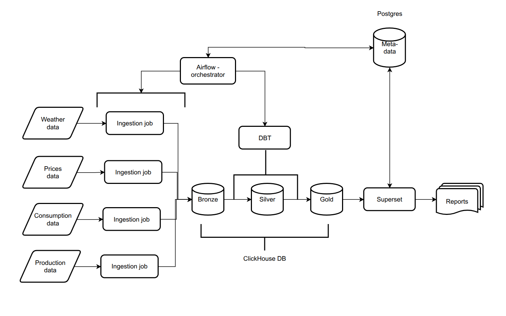

# DE2026-Group10
The project of Group 10 for the Data Engineering course in Fall 2026.

The objective of the project is to provide analytics related to electricity prices, combined with the weather data and historical consumption.

## Architecture



## Running the stack

The whole pipeline runs locally with Docker Compose: Postgres (metadata), ClickHouse (warehouse),
Airflow (orchestrator, which also runs dbt) and Superset (dashboards).

**You need**: Docker Desktop or Docker Engine with Compose v2, and `make`. The stack uses about
2–4 GB of memory; give Docker at least 4 GB, 8 GB is comfortable. Ports 8080, 8088 and 8123 must
be free, or set other ports in `.env`.

```bash
cp .env.example .env   # local placeholder settings; on Linux also set AIRFLOW_UID=$(id -u)
make up                # build, start, and wait until every service is healthy
```

| Command | What it does |
|---|---|
| `make up` | Build the images and start the stack. Returns when all services are healthy. |
| `make down` | Stop the stack. Data is kept. |
| `make reset` | Stop the stack and delete all warehouse and metadata data. |
| `make ps` | Show the services and their health. |
| `make logs` | Follow the logs of all services. |
| `make dbt-debug` | Check that dbt can connect to the warehouse. |
| `make lint` / `make format` / `make test` | Lint, format and test the Python code. |

| Service | URL | Login (from `.env`) |
|---|---|---|
| Airflow | <http://localhost:8080> | `AIRFLOW_ADMIN_USER` / `AIRFLOW_ADMIN_PASSWORD` (`admin` / `admin`) |
| Superset | <http://localhost:8088> | `SUPERSET_ADMIN_USER` / `SUPERSET_ADMIN_PASSWORD` (`admin` / `admin`) |
| ClickHouse (HTTP) | <http://localhost:8123> | `CLICKHOUSE_USER` / `CLICKHOUSE_PASSWORD` (`pipeline` / `pipeline`) |

Postgres is only reachable from inside the stack. The values in `.env.example` are for a local
machine only; never reuse them elsewhere. `.env` is git-ignored.

### What is in place

- **Warehouse**: empty databases `bronze`, `silver` and `gold`. The `pipeline` account writes to
  all three; `superset_reader` can only read `gold`.
- **Airflow**: one DAG, `open_meteo_weather`, paused until you switch it on. It runs every 6 hours
  (UTC): the forecast on every run, observed weather on the 00:00 run. Run files land in
  `ingestion/output/open_meteo/`. To also fetch observed weather on a manual run, trigger it with
  the `archive` option on. Switching the DAG on starts the most recent scheduled run right away,
  so a first manual trigger shows two runs.
- **dbt**: project `energy_analytics` in `dbt/`, connected to the warehouse, with the
  `bronze.open_meteo_weather` source declared.
- **Superset**: the warehouse is registered as `ClickHouse warehouse`, through the read-only
  account.

## Data Dictionary

See [infra/README.md](infra/README.md).

## Example Queries and DDL

See [docs/examples.sql](docs/examples.sql) for example queries.

See [infra/clickhouse/init/](infra/clickhouse/init/) for the warehouse initialisation (layer databases and the
read-only account). Table DDL is added by the loading features.

## Spec-Driven Development

Features are developed with [Spec Kit](https://github.com/github/spec-kit).

- Project principles: [.specify/memory/constitution.md](.specify/memory/constitution.md)
- Feature specs, plans and tasks: [specs/](specs/)

Workflow: `/speckit-specify` → `/speckit-clarify` → `/speckit-plan` → `/speckit-tasks` → `/speckit-analyze` → `/speckit-implement`.

Other commands: `/speckit-constitution` (update principles), `/speckit-checklist` (generate a quality checklist), `/speckit-converge` (add tasks for unbuilt work).

No separate LLM disclosure file is provided, as the specs already cover LLM usage.
